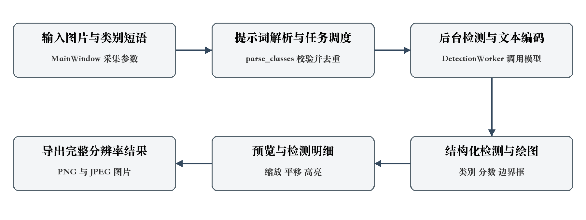
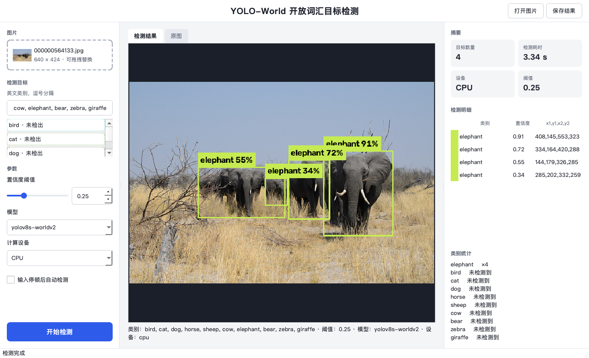
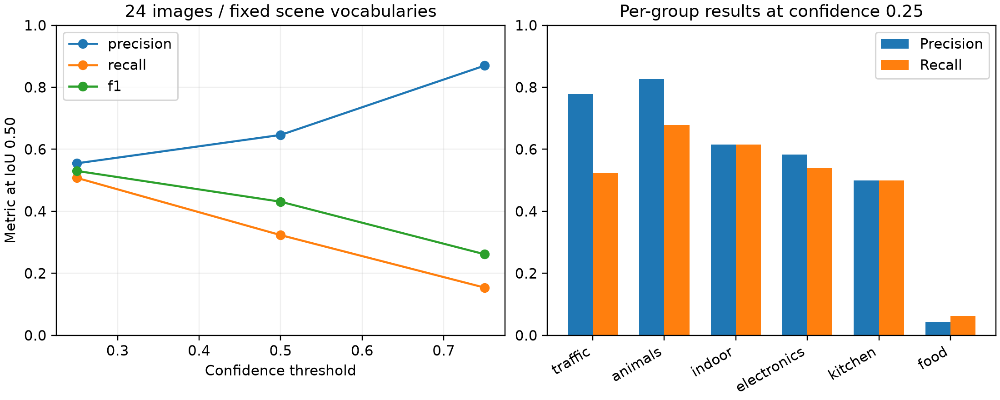
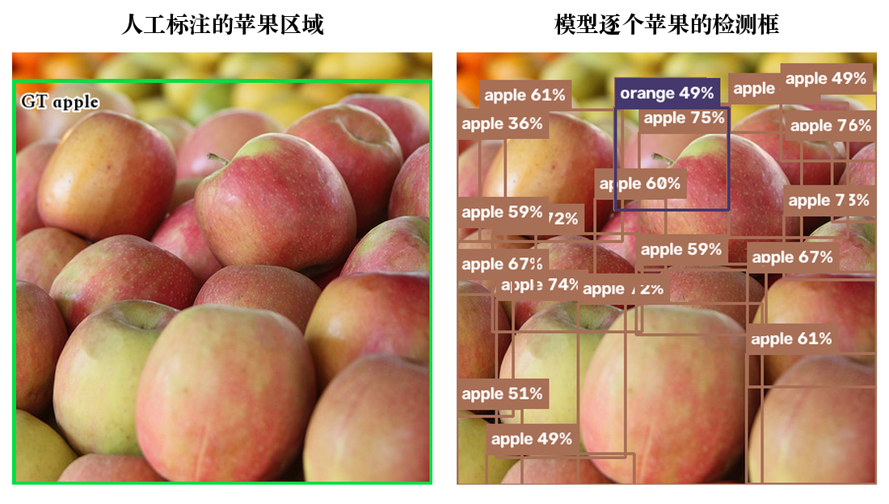

模式识别课程大作业

# 基于 YOLO World 的 开放词汇目标检测与可视化分析系统

课程报告

2026 年 10 月

## 摘要

针对固定类别检测系统在交互使用中需要更换检测目标的问题，本文基于预训练 YOLO-World v2 与 PyQt6，实现了以英文类别短语驱动的单图目标检测与可视化分析系统。系统完成提示词解析、模型推理、后台线程调度、检测框绘制、结果明细展示和图片导出，支持阈值调整、类别高亮、缩放平移及权重自动获取。用户可以在同一界面中更换类别词汇并观察检测结果。

实验从 COCO val2017 按六个目标类别分组固定抽取 24 张图片，完成 120 组检测与 30 次预热后的重复耗时测量。在置信度阈值 0.25、同类别 IoU 不低于 0.50 的匹配规则下，Precision、Recall 和 F1 分别为 55.46%、50.77% 和 53.01%；阈值升至 0.75 后，Precision 升至 86.96%，Recall 降至 15.38%。统一描述模板的表现低于标准类别词。系统回归测试共 62 项通过，实验展示了类别输入、检测结果和交互分析之间的完整工作流程。

关键词  开放词汇目标检测  YOLO-World  PyQt6  提示词  可视化分析

## 1 引言

目标检测同时回答图像中“有什么”和“在哪里”两个问题，是模式识别在场景理解中的典型应用。传统检测系统通常围绕训练时确定的类别运行。对实际使用者而言，检测需求却会随任务改变：同一张街景图片可能需要查看车辆、行人或交通设施。将检测目标转化为可编辑的文本输入，可以使检测过程更贴近这一使用方式。

视觉语言预训练将图像内容与文本描述建立联系，为类别可变的检测提供了基础。YOLO-World 将文本信息引入 YOLO 检测框架，使用户词汇能够参与推理[10]。本项目采用其预训练权重，围绕“输入目标—执行检测—查看依据—保存结果”设计桌面应用，并用统一实验流程分析阈值与短语形式对输出的影响。

项目工作主要包括三个部分：一是建立自由英文类别输入到模型类别设置的处理流程；二是实现后台推理与可交互结果展示，处理图片方向、中文路径和保存过程中的状态协调；三是组织带人工标注的多场景实验，统计检测指标、目标尺度表现及运行耗时。系统面向单张图片的检测分析，模型能力与交互功能分别通过实验和软件测试评价。

## 2 相关工作

### 2.1 目标检测方法

深度学习目标检测形成了多种实现路线。Faster R-CNN 通过区域建议网络与检测网络共享卷积特征，将候选区域生成与目标识别结合起来[2]。YOLO 将目标检测组织为统一的预测过程，直接输出边界框与类别信息[1]。SSD 在不同尺度特征图上使用默认框进行预测，以覆盖不同尺寸的目标[3]。这些方法奠定了检测系统中图像特征提取、位置回归与类别判断的常用处理方式。

DETR 将检测表示为集合预测，利用 Transformer 与二分匹配建立预测目标和真实目标的对应关系[4]。不同结构在候选区域、特征交互和后处理方式上各有特点。对本项目而言，选择检测组件还需要考虑文本类别接入、Python 调用方式和桌面部署流程。

### 2.2 视觉语言与开放词汇检测

CLIP 通过图像与文本配对学习共享语义表示，使用文本描述组织视觉概念[5]。ViLD 将视觉语言模型中的知识蒸馏到检测器，使候选区域表示与图文语义表示对齐[6]。OWL-ViT 则将图文预训练的视觉 Transformer 适配到文本条件目标检测[7]。这些工作说明，类别名称可以作为模型输入参与视觉目标定位。

GLIP 联合目标检测和短语定位任务开展预训练，把语言与目标级视觉表征联系起来[8]。Grounding DINO 在特征增强、语言引导的查询选择及跨模态解码阶段融合图文信息，支持类别名称和指代表达输入[9]。相较于固定类别识别，开放词汇检测更关注文本表征如何与图像区域建立对应关系。

### 2.3 YOLO World 与项目实现

YOLO-World 在 YOLO 框架中引入视觉语言交互，提出可重参数化的视觉语言路径聚合网络 RepVL-PAN，并通过区域与文本之间的对比学习组织预训练[10]。本项目通过 Ultralytics 的 YOLOWorld 接口加载 YOLOv8s-Worldv2，使用 set_classes 设置用户词汇，再由 predict 输出检测结果[13]。

本文在上述模型能力之上完成交互系统设计与工程实现：将自由输入规范化为模型可调用的类别列表，通过 Qt 后台线程执行检测，再将结构化结果用于绘图、明细展示和交互高亮。实验关注这套实现中的参数响应、提示词敏感性和检测表现，形成模型调用、界面操作与结果分析相衔接的课程作品。

## 3 系统总体设计

### 3.1 输入输出与处理流程

系统输入包括一张本地图片、英文类别短语列表、置信度阈值及计算设备。输出为带有类别和分数标签的检测图片，以及每个目标的类别名称、模型分数和边界框坐标。界面支持 JPG、JPEG、PNG、BMP 文件，导出采用 PNG 或 JPEG 格式。

图 1 系统处理流程

主窗口采集参数后先进行提示词解析与输入校验，再把检测任务交给后台线程。线程完成权重准备、设备选择、文本类别设置和模型预测，将检测结果转为统一结构。绘图模块按原图尺寸绘制边界框，主线程接收结果并更新预览、类别标签和明细表。保存操作读取完整分辨率结果图。

### 3.2 模块划分

| 模块 | 主要职责 |
| --- | --- |
| class_parser.py | 分隔短语、规范空白、类别去重及输入校验 |
| detector.py 与 device.py | 加载模型、设置词汇、执行预测及选择设备 |
| model_assets.py | 固定地址获取权重、大小与 SHA-256 校验 |
| image_io.py 与 visualizer.py | 图片读写、EXIF 方向处理及检测框绘制 |
| gui/main_window.py 与 worker.py | 界面交互、任务调度、线程信号及结果展示 |

表 1 系统模块及职责

各模块通过类别列表、检测记录和图像对象传递数据。检测记录统一包含 class_name、confidence 和 bbox，绘图与界面均使用这一结构。界面样式集中在 gui/style.py，实验工具集中在 scripts，自动回归测试集中在 tests。

## 4 关键实现

### 4.1 自由类别解析与模型调用

类别输入使用逗号分隔，同时兼容中文逗号。解析器保留 traffic light 等多词短语，清理连续空白和空项，按忽略大小写的方式去重并保留首次写法。输入为空或包含中文汉字时，界面给出明确提示。解析后的字符串列表直接传给 set_classes。

检测器加载一次权重后保存最近使用的类别元组；类别变化时更新文本设置，仅调整阈值时复用现有设置。预测结果逐框转换为类别、浮点分数和 xyxy 坐标，供后续模块使用。这样可以将模型推理与界面展示分开维护。

图 2 系统实际界面及 COCO 图片检测结果

### 4.2 后台执行与交互状态

界面使用 QThread 执行检测，通过信号返回状态、结果与错误信息[14]。检测期间锁定图片与参数修改；保存对话框打开时暂停自动检测，并使用进入对话框前的结果快照。用户点击类别或明细行时，界面高亮对应目标；缩放、平移与高亮作用于预览，导出图保持完整分辨率。

### 4.3 图片与运行资源管理

图片读写采用字节解码与编码处理中文路径，并统一处理 EXIF 方向。权重下载使用固定版本、文件大小和 SHA-256 校验，成功后原子替换本地文件。自动设备模式依次检查 MPS、CUDA 与 CPU；加速设备执行失败时显示原因并使用 CPU 重试一次。软件回归测试覆盖输入、缓存、线程、保存及下载流程，共 62 项通过。

## 5 实验设计

### 5.1 数据集与运行环境

实验使用 COCO val2017 的图片与人工实例标注[11]。候选图片按 ID 排序，限定为许可编号 4 的 CC BY 2.0 图片，要求包含分组锚点类别及至少两个该组非 crowd 实例；使用随机种子 20261022，每组抽取四张且组间图片不重复。图片、提示词与负向查询在检测前固定，样本总数为 24 张。

| 类别分组 | 图片数 | 词汇示例 |
| --- | --- | --- |
| 交通与街景 | 4 | person、car、traffic light |
| 动物 | 4 | dog、horse、elephant |
| 室内家具 | 4 | chair、couch、dining table |
| 电子设备 | 4 | laptop、keyboard、cell phone |
| 厨房与器具 | 4 | bowl、oven、refrigerator |
| 食物 | 4 | apple、orange、cake |

表 2 测试图片分组与词汇示例

模型使用 YOLOv8s-Worldv2 固定预训练权重，运行设备为 macOS arm64 平台 CPU。实验记录的版本为 Python 3.11.17、Ultralytics 8.4.177、PyTorch 2.14.1、OpenCV 5.0.0.93；输入尺寸参数为 640，NMS IoU 为 0.70，max_det 为 300。

### 5.2 条件设置与评价指标

每张图片运行五种条件：标准类别词下的 0.25、0.50、0.75 三档阈值；阈值 0.25 下，将每个类别改写为 a photo of a 加类别名的描述模板；另在阈值 0.25 下查询三个在该图全部实例标注中未出现的类别。24 张图片共形成 120 组检测。

评价按各图预设分组词汇进行。预测按分数降序，与同类别、未被匹配的人工框进行最大 IoU 一对一匹配，IoU ≥ 0.50 记为 TP；未匹配输出记为 FP，未匹配人工实例记为 FN。普通实例优先匹配；与同类 crowd 区域的交集占检测框面积比例 ≥ 0.50 的剩余输出予以忽略。

Precision = TP / (TP + FP)     Recall = TP / (TP + FN) F1 = 2TP / (2TP + FP + FN)

指标使用总计数的微平均，并以分层 bootstrap 估计区间[12]：六组各有放回抽取四张，重复 2000 次，取 2.5% 和 97.5% 分位数。耗时实验在每组第一张图片上先预热一次，再连续检测五次，共记录 30 个样本。

## 6 实验结果与分析

### 6.1 阈值影响与总体表现

| 条件 | TP | FP | FN | P 百分比 | R 百分比 | F1 百分比 |
| --- | --- | --- | --- | --- | --- | --- |
| 阈值 0.25 | 66 | 53 | 64 | 55.46 | 50.77 | 53.01 |
| 阈值 0.50 | 42 | 23 | 88 | 64.62 | 32.31 | 43.08 |
| 阈值 0.75 | 20 | 3 | 110 | 86.96 | 15.38 | 26.14 |
| 描述词 0.25 | 51 | 78 | 79 | 39.53 | 39.23 | 39.38 |

表 3 各条件下的微平均检测结果 共 130 个非 crowd 目标

默认阈值 0.25 下，66 个预测与人工框匹配，53 个输出未匹配，64 个目标未匹配，另有一个 crowd 区域输出被忽略。对应 Precision 为 55.46%，Recall 为 50.77%。按图片重采样得到的 95% 区间分别为 40.29%—70.59% 和 42.48%—61.35%，反映当前分组中不同图片的表现差异。

图 3 阈值变化及各类别分组的检测指标

阈值升至 0.50 后，FP 从 53 降至 23，但 TP 同时从 66 降至 42，Recall 降为 32.31%。继续升至 0.75，Precision 达到 86.96%，Recall 为 15.38%。高阈值保留分数较高的输出，也使更多人工标注目标在输出中缺失。三档阈值中，0.25 的 F1 为 53.01%，高于另外两档，适合作为本系统观察较完整检测结果的默认设置。

固定阈值实验显示，Precision 的提高需要与 Recall 的变化一起判断。对于结果核查，较高阈值可以减少待检查框；对于寻找更多候选目标，较低阈值保留的信息更多。界面因此将阈值作为直接可调参数，并同时显示每个输出的模型分数。

### 6.2 场景与目标尺度

| 分组 | GT | TP | FP | FN | P 百分比 | R 百分比 |
| --- | --- | --- | --- | --- | --- | --- |
| 交通与街景 | 40 | 21 | 6 | 19 | 77.78 | 52.50 |
| 动物 | 28 | 19 | 4 | 9 | 82.61 | 67.86 |
| 室内家具 | 13 | 8 | 5 | 5 | 61.54 | 61.54 |
| 电子设备 | 13 | 7 | 5 | 6 | 58.33 | 53.85 |
| 厨房与器具 | 20 | 10 | 10 | 10 | 50.00 | 50.00 |
| 食物 | 16 | 1 | 23 | 15 | 4.17 | 6.25 |

表 4 默认阈值下的各分组表现

动物组的 Precision 为 82.61%、Recall 为 67.86%，交通组为 77.78% 和 52.50%。电子设备与厨房图片中，输出包含类别混淆或定位偏差。食物组的统计明显偏低，其中水果图片既包含模糊背景目标，也存在人工区域标注与逐个目标输出的粒度差异，该案例在下一节展开。每组四张图片的类别、目标数量和成像条件共同构成了组间差异。

| 目标尺度 | 面积条件 | GT | TP | Recall 百分比 |
| --- | --- | --- | --- | --- |
| 小目标 | area < 32² | 63 | 25 | 39.68 |
| 中目标 | 32² ≤ area < 96² | 35 | 20 | 57.14 |
| 大目标 | area ≥ 96² | 32 | 21 | 65.62 |

表 5 按 COCO 分割区域面积划分的目标尺度结果

小目标共 63 个，其中 25 个匹配，Recall 为 39.68%；大目标的 Recall 为 65.62%。远处行人、交通设施与厨房小器具在图像中占据的像素较少，密集背景使定位和类别判断更困难。尺度统计保留各图的原始场景与类别条件。

### 6.3 描述性提示词与负向查询

把标准类别词统一改写为 a photo of a 加类别名后，TP 从 66 降至 51，FP 从 53 增至 78，Precision 与 Recall 分别变为 39.53% 和 39.23%。在这批图片和统一模板下，短类别词更有效。系统保留直接输入类别短语的交互方式，用户可更换措辞并查看实际检测结果。

负向组每张图片查询三个在标注中未出现的类别。24 张图片中有四张产生输出，共五个框，出现输出的图片比例为 16.67%。看图复核发现，列车区域被输出为 bus，沙发区域被输出为 bed，笔记本电脑区域被输出为 book，甜点盘附近的大范围区域被输出为 vase 和 wine glass。这些案例说明，即使查询词未出现在人工标注中，视觉近似仍会引起模型响应。

### 6.4 标注粒度与失败案例

图 4 水果图片局部的人工标注与模型输出对比 图片 ID 406570

该图的 apple 标注使用一个大框覆盖前景多枚苹果，iscrowd 为 0；模型则输出多个单独苹果框。这些小框与大参考框的 IoU 低于 0.50，因而计入 FP。同时，背景 orange 目标存在未匹配实例。该图按固定规则得到 TP=0、FP=20、FN=7。它表明，检测评价同时受到对象类别、定位尺度和参考标注粒度的影响，食物组的微平均因此需要结合图像内容解读。

### 6.5 运行耗时

| 测量项 | 结果 |
| --- | --- |
| 模型构造 | 0.023 s |
| 首次 detect 调用 | 2.252 s |
| 预热后均值与标准差 | 0.0575 s ± 0.0051 s |
| 预热后中位数与 P95 | 0.0580 s 与 0.0656 s |

表 6 本机 CPU 检测耗时 预热后共 30 次测量

计时覆盖 detect 函数内的图片读取、预处理、预测、后处理与结果整理。每组先预热并复用类别设置，绘图、保存及界面刷新在计时区间之外。首次调用包含文本编码与推理组件初始化，耗时高于后续重复检测。

## 7 总结

本文完成了基于 YOLO-World 与 PyQt6 的开放词汇单图检测系统，将自由英文类别输入、后台推理、结果明细与图片导出连接为完整操作流程。多场景实验给出了阈值、提示词形式和目标尺度对应的检测表现，并通过负向查询与标注粒度案例分析错误来源。后续可围绕细粒度目标的标注一致性、小目标表现及不同类别表达开展扩展评价，继续改进检测结果的可解释展示。

## 参考文献

[1] Redmon J, Divvala S, Girshick R, et al. You Only Look Once: Unified, Real-Time Object Detection[C]. CVPR, 2016. [原文](https://arxiv.org/abs/1506.02640)

[2] Ren S, He K, Girshick R, et al. Faster R-CNN: Towards Real-Time Object Detection with Region Proposal Networks[C]. NeurIPS, 2015. [原文](https://arxiv.org/abs/1506.01497)

[3] Liu W, Anguelov D, Erhan D, et al. SSD: Single Shot MultiBox Detector[C]. ECCV, 2016. [原文](https://arxiv.org/abs/1512.02325)

[4] Carion N, Massa F, Synnaeve G, et al. End-to-End Object Detection with Transformers[C]. ECCV, 2020. [原文](https://arxiv.org/abs/2005.12872)

[5] Radford A, Kim J W, Hallacy C, et al. Learning Transferable Visual Models From Natural Language Supervision[C]. ICML, PMLR 139, 2021: 8748–8763. [原文](https://proceedings.mlr.press/v139/radford21a.html)

[6] Gu X, Lin T Y, Kuo W, et al. Open-vocabulary Object Detection via Vision and Language Knowledge Distillation[C]. ICLR, 2022. [原文](https://arxiv.org/abs/2104.13921)

[7] Minderer M, Gritsenko A, Stone A, et al. Simple Open-Vocabulary Object Detection with Vision Transformers[C]. ECCV, 2022. [原文](https://arxiv.org/abs/2205.06230)

[8] Li L H, Zhang P, Zhang H, et al. Grounded Language-Image Pre-training[C]. CVPR, 2022. [原文](https://arxiv.org/abs/2112.03857)

[9] Liu S, Zeng Z, Ren T, et al. Grounding DINO: Marrying DINO with Grounded Pre-Training for Open-Set Object Detection[C]. ECCV, 2024. [原文](https://arxiv.org/abs/2303.05499)

[10] Cheng T, Song L, Ge Y, et al. YOLO-World: Real-Time Open-Vocabulary Object Detection[C]. CVPR, 2024. [原文](https://arxiv.org/abs/2401.17270)

[11] Lin T Y, Maire M, Belongie S, et al. Microsoft COCO: Common Objects in Context[C]. ECCV, 2014: 740–755. [原文](https://doi.org/10.1007/978-3-319-10602-1_48)

[12] Efron B. Bootstrap Methods: Another Look at the Jackknife[J]. The Annals of Statistics, 1979, 7(1): 1–26. [原文](https://doi.org/10.1214/aos/1176344552)

[13] Ultralytics. YOLO-World Model[EB/OL]. 访问日期 2026-10-22. [原文](https://docs.ultralytics.com/models/yolo-world/)

[14] The Qt Company. QThread Class Qt 6.11[EB/OL]. 访问日期 2026-10-22. [原文](https://doc.qt.io/qt-6.11/qthread.html)
